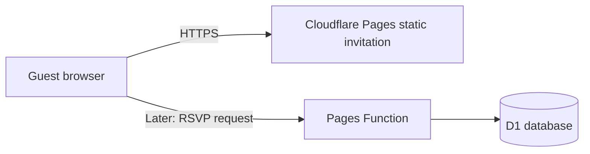

# 03. Architecture

## Options considered

| Option | Reuse | Operations and cost | Data and risk | Fit |
|---|---|---|---|---|
| Existing CodeIgniter + SQLite, hosted on the owner's PC with Tunnel | Highest nominal code reuse | $0 provider cost, but machine and tunnel must stay running | SQLite and media remain local; source is obfuscated and not auditable | Not suitable for a dependable public invitation |
| PHP + MySQL on shared free PHP hosting | Could preserve PHP patterns, but current SQLite code needs conversion | Simple FTP-oriented deploy; provider terms/resource limits vary | DB quota, backup and uptime guarantees require further provider confirmation | Possible only if retaining PHP is a hard requirement |
| Cloudflare Pages + native HTML/CSS/JS; Functions + D1 for P1 | Reuses approved visual assets and content ideas, not application code | Static P0 can fit the free tier; no server or domain purchase for demo | Managed D1 later, with quotas and 7-day Free Time Travel; export for independent recovery | **Recommended** |
| PHP Docker on Cloud Run + Neon Postgres | Reuses PHP knowledge; not obfuscated app | Cloud Run has a usage-based free allowance, but requires billing and has no hard zero-cost guarantee | Neon external DB has free quotas and scale-to-zero; cross-provider config | Backup option if PHP is mandatory |

## Decision

Build the approved P0 as a static site hosted on Cloudflare Pages. Use plain HTML, CSS and JavaScript; no front-end framework or bundler is justified for this scope. The Pages URL provides HTTPS and a provider subdomain. Keep event details in the page initially.

If P1 is approved, add a small Pages Function and D1 database for RSVP/wishes. The function owns validation and database access. Never put database credentials or private data in browser JavaScript. No admin is included in P0/P1 by default.

## Request/data flow

## Security boundaries

P0 has no user-submitted data or secrets. For P1, validate on the server, use bound SQL parameters, escape output for its HTML context, rate-limit submissions, constrain payload length, and return no guest-list data. Restrict CORS/origin behavior to the site where practical. Export D1 periodically; test restore before relying on it.

## Migration posture

Do not migrate the old hidden PHP runtime. Recreate only approved requirements in V2. Inspect every reused CSS/JS/SVG/font/media asset individually. Preserve SQLite migration ideas as documentation, but design new D1 migrations only when P1 is authorized.
