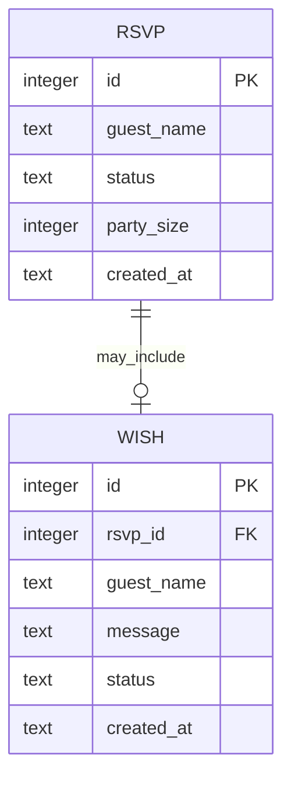

# 05. Database Design

## P0

No database is required for the approved static invitation release. Couple names, schedule and venue are static content in the site. Do not create empty tables or a login just in case.

## P1 proposal: D1 (SQLite dialect)

Create tables only after RSVP and wishes are approved. Since the current release is one invitation and one event, event configuration can remain static. Initial schema needs only a response table and a wishes table if wishes are independently moderated. Guest names/phone numbers are optional and should not be collected unless the couple needs them.

### Proposed entities

### Table sketch

| Table | Columns and types | Constraints/indexes | Validation and privacy |
|---|---|---|---|
| `rsvps` | `id INTEGER PRIMARY KEY`, `guest_name TEXT NOT NULL`, `status TEXT NOT NULL`, `party_size INTEGER NOT NULL DEFAULT 1`, `created_at TEXT NOT NULL` | Index `(status, created_at)` only if queries need a summary. No public unique constraint unless per-guest tokens are later introduced. | Name 1-100 chars; status constrained to `yes`/`no`; party size 1-10 for yes and 0/1 for no per product decision. Don't collect phone or address by default. |
| `wishes` (optional) | `id INTEGER PRIMARY KEY`, `rsvp_id INTEGER NULL`, `guest_name TEXT NOT NULL`, `message TEXT NOT NULL`, `status TEXT NOT NULL DEFAULT 'pending'`, `created_at TEXT NOT NULL` | FK to `rsvps(id)` if linking is needed; index `(status, created_at)`. If wishing without RSVP, keep nullable FK or omit it. | Name <=100 chars; message <=1000 chars; status constrained to pending/approved/hidden; render as escaped text, never raw HTML. |

No `weddings` or `admin_users` table is needed for one static invitation with no admin. If later adding multiple invitations or editable content, add an `invitations` table then and define its ownership/auth boundary first.

## API and access rules

- Browser may submit a new RSVP/wish; it may not query the full response list.
- Read-only public wishes require moderation and pagination; omit from first P1 unless requested.
- Use prepared/bound parameters and server-side validation. Add rate controls and origin/CSRF controls appropriate to the final request pattern.
- Do not log full guest messages or unnecessary identifiers. Avoid storing IPs unless a measured abuse-control need justifies short retention.

## Migration and recovery plan

1. Start with a versioned D1 migration creating only approved tables and constraints.
2. Test against a local D1 database, then apply to the production binding.
3. Before meaningful data updates, export with Wrangler to a private, backed-up location; do not commit guest data to Git.
4. D1 Time Travel on Free currently covers up to 7 days on production-backend databases. Restore overwrites in place; export is the independent recovery path.
5. Test SQL export/import and a restore before collecting real guest data. Document operator access separately; no admin UI is included by default.

## Sample records

Only use fake test data, e.g. `guest_name = 'Khach thu'`, `status = 'yes'`, `party_size = 2`, `message = 'Chuc mung hai ban!'`. Delete test records before production.
